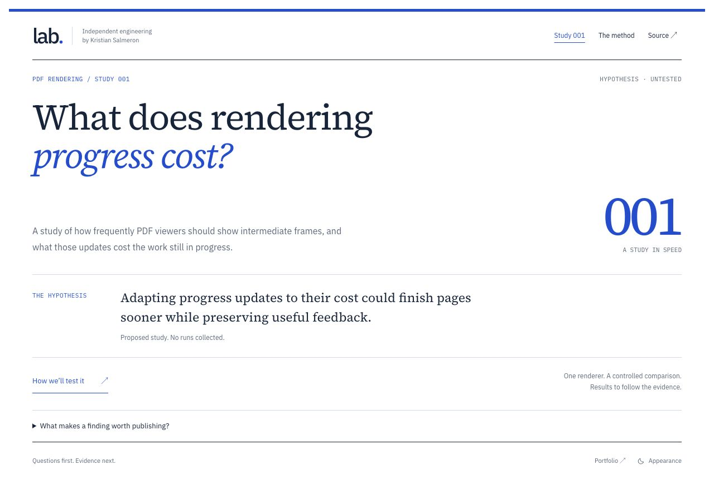

# Validation history

The following records validation of the earlier foundation revision. The current publication design and proposed PDF study require the current verification run; the earlier screenshots are historical.

# Engineering Lab foundation validation

Reviewed November 8, 2026, on the `codex/lab-foundation` feature branch. The initial repository commit is `24c8ac7b36600a9851ac9d36e5e58210555e78e3`.

## Delivered scope

- Independent Next.js 16.4.5, React 19.3.1, and TypeScript 5.9.3 application.
- Research homepage, experiment index, Experiment 001 protocol, methodology, and custom 404.
- Self-hosted typography, light/dark appearance, cross-site navigation, canonical/social metadata, sitemap, robots, and social image source.
- Typed metadata registry and experiment-owned document content, with an explicit protocol/publication boundary.
- Authoring, measurement, architecture, future release instructions, and read-only CI checks.

Experiment 001 is a protocol only. No interactive grid, runner, measurement collector, charts, exports, benchmark values, or performance findings have been implemented or published in this foundation.

## Automated verification

Using Node 22.23.4:

- Default `npm ci`: passed from the lockfile, without force or peer-compatibility flags. The known upstream ESLint plugin peer warnings are documented in the README.
- Prettier check, ESLint with no lint warnings, and strict TypeScript: passed.
- All 13 tests: passed (five appearance contracts, four registry/publication contracts, three export-audit regressions, one sharing-title regression).
- Production static build: passed.
- Export audit: passed for four canonical content routes, custom noindex 404, crawler files, fragments, and 12 referenced local resources.
- `git diff --check`: passed.

The appearance tests cover pre-hydration preference application, persistence, blocked storage, cross-tab updates, unrelated-data preservation, and listener cleanup. Registry checks keep protocols out of published findings. The export checks inspect actual HTML and local resources; they do not validate future scientific conclusions.

## Local browser review

Reviewed the production export at desktop (1280px), tablet (768px), and mobile (390px and 320px) widths. No horizontal document overflow was observed. Checked research navigation, protocol and methodology reading layouts, light/dark behavior with reload persistence, and keyboard skip-to-main focus. Browser warning/error logs were empty on the final homepage review.

Direct HTTP checks returned 200 for all four content routes and 404 for an unregistered experiment. The custom 404 recovery links were also inspected in the browser. Content landmarks and headings are present in exported HTML before JavaScript executes; the appearance button is progressively enabled after hydration.

This is not a full cross-browser or screen-reader certification. No Core Web Vitals or grid benchmark results are claimed by these checks.

## Release boundary

Only source-control work is included. No hosting service, production deployment, custom-domain association, DNS record, analytics service, or database was created. The CI workflow verifies code and static output; it has no deployment action. Portfolio, Toolbox, and CareIQ are not modified by this repository.
